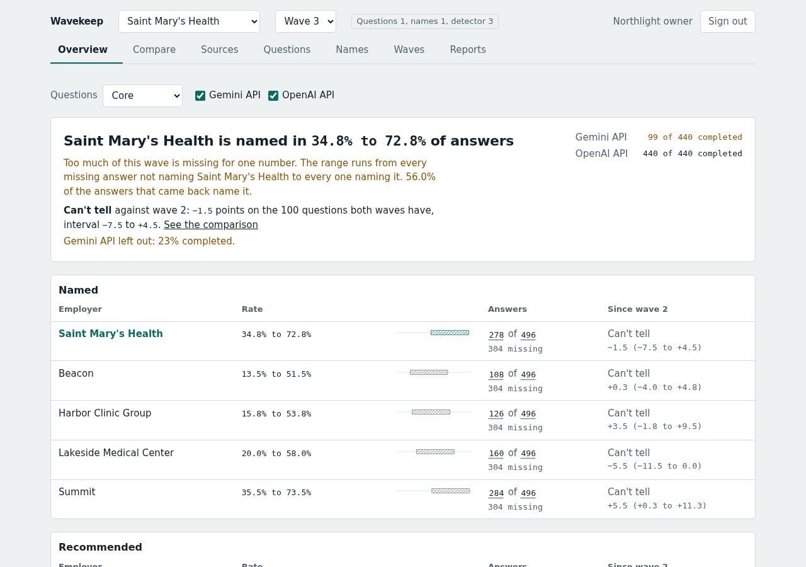

# Wavekeep

Whether AI assistants name an employer, and whether that changed.

People ask an assistant where they should work. Wavekeep asks a fixed set of questions on a schedule, saves every answer with its sources, and says what moved between one wave of questions and the next. The second half is the hard one.



All employers, questions and answers in the repo are made up.

## The problem it's built around

In the third demo wave the Gemini adapter lost 341 of its 440 captures. Leave the failures out, which is the usual advice, and Saint Mary's Health went from 44.9% to 56.0%. Nothing had changed. Gemini names it less often, and most of Gemini was gone.

So two pooled rates are never subtracted. Wavekeep compares the same question on the same engine, leaves out an engine that completed under 90%, and treats question families as the unit because repeats of one question move together. On that wave it says −1.5 points, interval −7.5 to +4.3, can't tell. The rate itself is drawn as the range the missing answers allow, 34.8% to 72.8%.

A wave also has to stay closed for any of this to hold. The worker and the closer lock the wave row, and the count is its own statement after the lock. `packages/service/src/waves.ts` has it, and `bench/late.ts` shows what happens without it.

Every number is identified by its wave, question set, name set and detector version. The four are in the URL and they're the cache key, so nothing is ever invalidated.

## Run it

Node 24, pnpm 10 and Docker.

```
pnpm demo
```

Then open http://127.0.0.1:4310 and sign in as `owner@northlight.example` with the password `demo`. `client@northlight.example` is a client account, and `owner@tidewater.example` is another workspace. Answers are played back, so it costs nothing. For live engines, fill in `.env.example`.

## Layout

| Where | What |
| --- | --- |
| `packages/core` | Comparison, intervals, mention finding, URL cleaning. No I/O |
| `packages/engines` | OpenAI, Gemini and Claude adapters, replay, judges |
| `packages/service` | Schema, row-level security, waves, counting, reports, the one query layer |
| `apps/web` | Next.js 16, React 19 |
| `apps/api` | Hono, OpenAPI 3.1, MCP server |
| `apps/worker` | pg-boss jobs in the same Postgres |
| `docs/specs`, `docs/decisions` | One page per feature, and the short arguments |

`pnpm check`, `pnpm test`, `pnpm mutants` and `scripts/e2e.sh` are the checks. Tests start their own Postgres 18.3 unless `WAVEKEEP_TEST_PG` points at one.

## Results

| Check | Target | Measured | |
| --- | --- | --- | --- |
| Unchanged brand reported as changed, 2,000 pairs each | Under 6% in 4 situations | 3.2%, 3.2%, 4.6%, 4.8%. The pooled test: 1.6%, 40.0%, 5.7%, 10.9% | Met |
| Real lift of 0.6 log-odds, engines up | At least half found | 56.2%. With an engine down, 32.0% | Met |
| Number against its evidence | Equal, 10,000 random filters | 0 differ across query layer, API, MCP server and saved answers. 5,864 of the filters were distinct. In the browser, 360 of 360 numbers clicked | Met |
| Answers landing after a close | 0 in 5,000 forced races | 0 in 5,000. Without the locks, 547 in 1,000 | Met |
| Approved report after 50 name and detector changes | Byte-identical | 50 of 50, while the current number took 19 different values | Met |
| Worker killed at random | 200 kills, none lost or counted twice | 200 kills, 880 captures, 250 asked again, 0 lost, 0 counted twice | Met |
| Mention finding, 300 labeled answers | Precision 98%, recall 95% | Precision 97.5%, recall 79.8% on answers it wasn't tuned on | Missed |
| Recommendation judge against two people | Within 3 points | Not measured. Nobody has labeled the answers, so the model judge is off and a rule is used | Not measured |
| Cross-tenant reads | 0 on every route, cached function and API call | 0. Every route in the OpenAPI document, every page, the MCP server and each web route | Met |
| Scripts and instructions planted in answers | Nothing runs, no label changes | 12 plants, nothing ran or loaded. Labels hold for the rule judge, the model judge wasn't run | Partly met |
| Overview API, 1 million answers, 50 users | p95 under 300 ms | p95 226 ms and p99 2.5 s from a cold start, at 480,000 answers. The million wasn't run, the machine had no room | Partly met |
| Interaction to next paint, CPU slowed 4 times | Under 200 ms at p75 | Worst screen 40 ms | Met |
| Accessibility | No axe violations, full keyboard run | 0 on every screen and the drawer, light and dark. Keyboard run passes | Met |
| Mutants killed | At least 85% | Comparison 89.2%, saving and closing 98.1% | Met |
| Each step live behind its own check | 6 of 6 | The checks run locally. Nothing is deployed | Missed |
| Setup | One command | `pnpm demo`, about 40 seconds with the packages already installed | Met |

Raw output is in `results`. The machine was shared and busy, so read the timings as an upper bound.

## What hasn't been done

- The live adapters have been run against a local server speaking each provider's format. They haven't been run against the providers.
- The CI workflow, the container image and the Vercel config are written and haven't been run.
- Error reporting to Sentry is left out. Traces go out over OpenTelemetry when an endpoint is set.
- The rate limit counts in one process. Two API instances would each allow the full limit.
- The overview makes fifteen comparisons and doesn't correct for that. `docs/decisions/verdict-needs-both.md` says what follows from it.
- Failures inside an engine are taken as they come. Above the 90% floor, if the lost answers differ from the kept ones, a small bias gets through.
